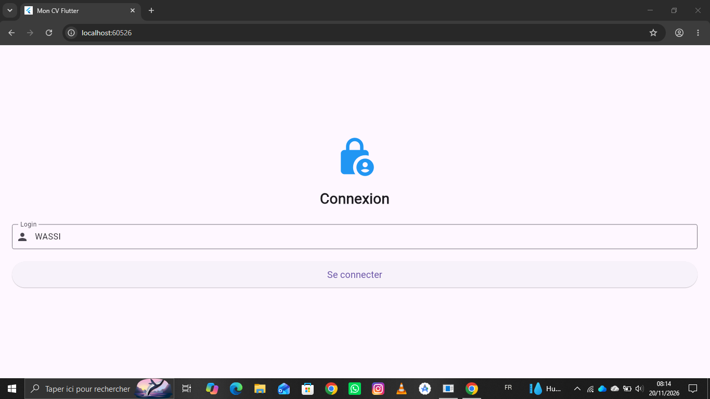
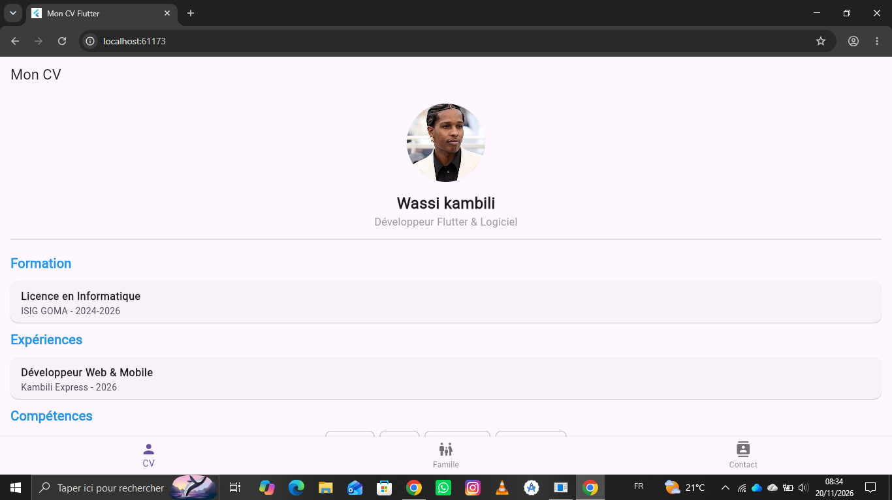
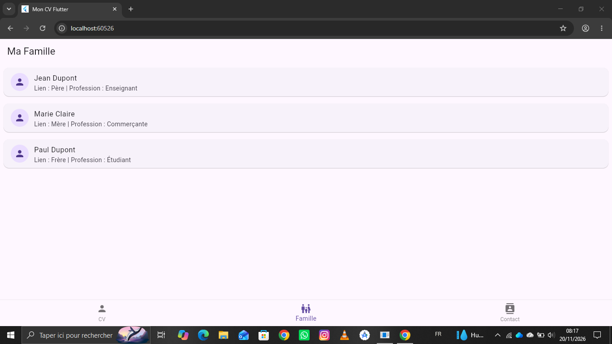
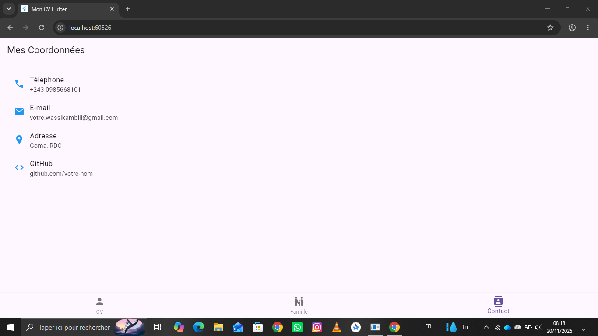

# cv_flutter_kambili

application mobile flutter presentant mon cv complet, ma famille et mes coordonees, accessible via une page login
**Depot GIT HUB public :**
## captures d'ecran

### page 1 login

### page 2 home(cv)

### page 3 famille

### page 4 contact
